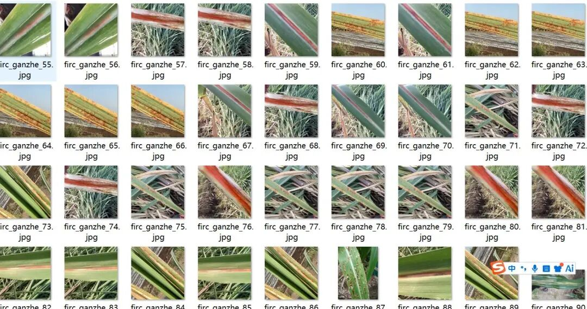
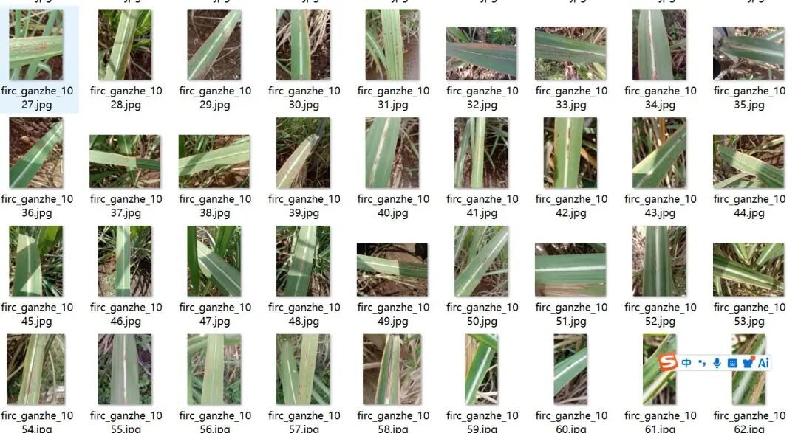
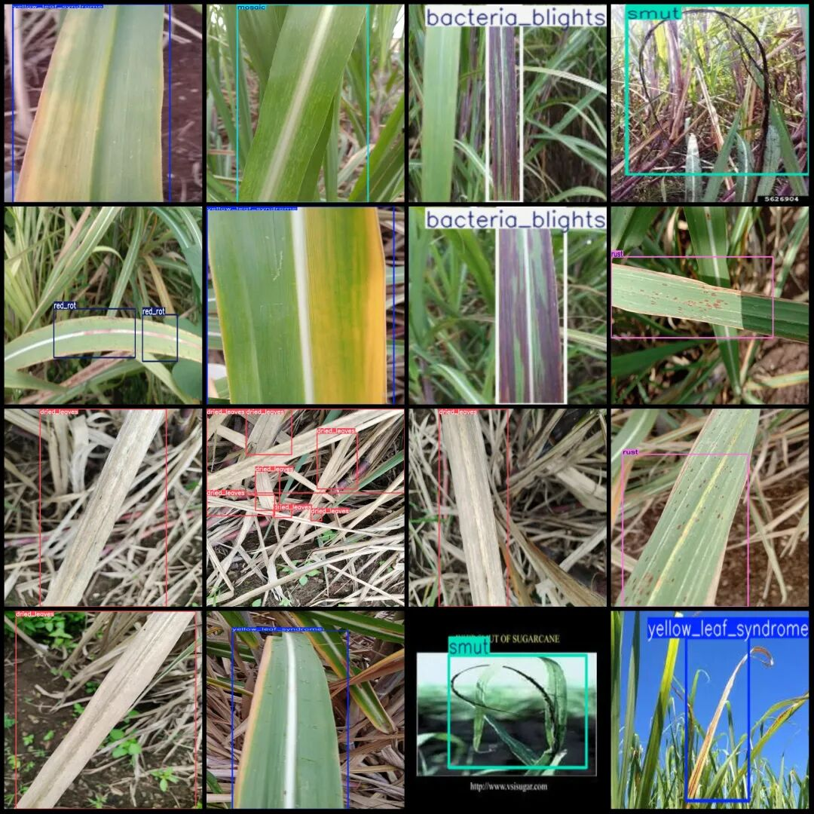
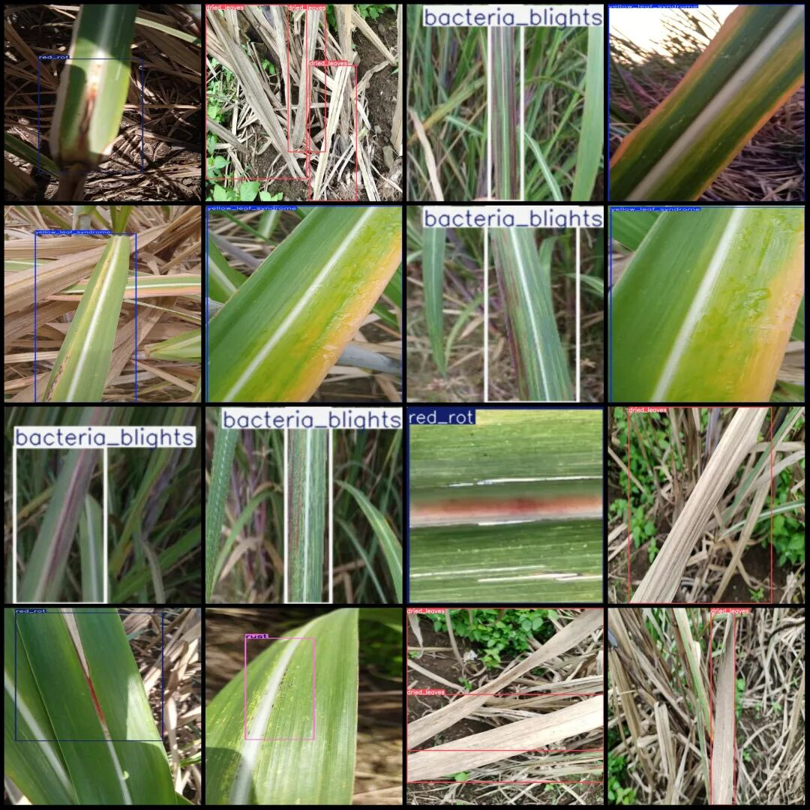

# Intelligent Agriculture Sugarcane Leaf Disease Detection Dataset VOC+YOLO format with 1248 images in 15 categories

Dataset format: Pascal VOC format + YOLO format (txt file without split path, only containing jpg images and corresponding VOC format xml files and yolo format txt files)

Number of images (number of jpg files): 1248

Number of annotations (number of xml files): 1248

Number of annotations (number of txt files): 1248

Label category count: 15

Label category names (Note that the order of labels in the YOLO format does not correspond to this, but is based on the classes.txt file in the labels folder): ["bacteria_blights", "brown_spot", "downey_mildew", "dried_leaves", "leaf_scald", "leaf_scorch", "mosaic", "pokkah_boeng", "red_rot", "red_spot", "ring_spot", "rust", "smut", "yellow_leaf_syndrome", "yellow_spot"]

Number of boxes labeled in each category:

Bacterial Blights (bacteria_blights) frame count = 191, occupying image count = 176

Brown spot (Blotch) frame count = 18, occupying image count = 16

Downey mildew (powdery mildew) frame count = 24, occupying picture count = 18

Dried leaves (dry leaves) frame count = 265, occupy picture count = 186

leaf_scald (Leaf scorch) frame count = 15, image count = 9

Leaf scorch (leaf scorch) frame count = 12, occupied picture count = 10

Mosaic (Leaf Blight) frame count = 187, occupying image count = 176

pokkah_boeng (sap rot) frame count = 24, occupy image count = 16

Red rot (red rot) frame count = 250, occupying image count = 216

Red Spot (Erythema) Frame Count = 6, Image Count = 3

Ringspot (ring spot) frame count = 46, occupy image count = 36

Rust (rust disease) frame count = 152, occupying picture count = 148

Smut (Black Smut) frame count = 42, occupying picture count = 36

Yellow leaf syndrome (yellow leaf syndrome) frame count = 211, occupying picture count = 197.

Yellow spot (yellow spot) frame count = 24, occupying picture count = 24.

Total frame count: 1467

Image resolution: Multi-resolution images, such as 180x180, 493x986, etc.

Using labelImg:

Annotation rules: Draw a rectangle around the category.

Important Notice: The dataset does not have separate training, validation, and test sets; you need to partition them yourself.

Special : This dataset does not guarantee the accuracy of the trained models or weight files.

Image Preview:

Annotation example:

## Payment

Here is a pay link on Stripe ( https://buy.stripe.com/3cs8yP7sY87d0vu9AB ). Please contact me lonlonago@foxmail.com after funding $89, and I will send you a complete data files , thank you!

